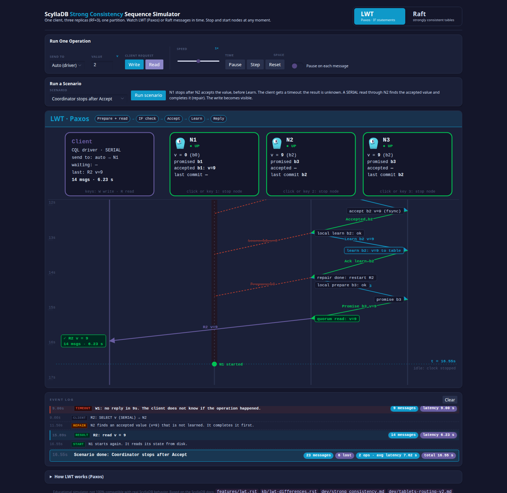
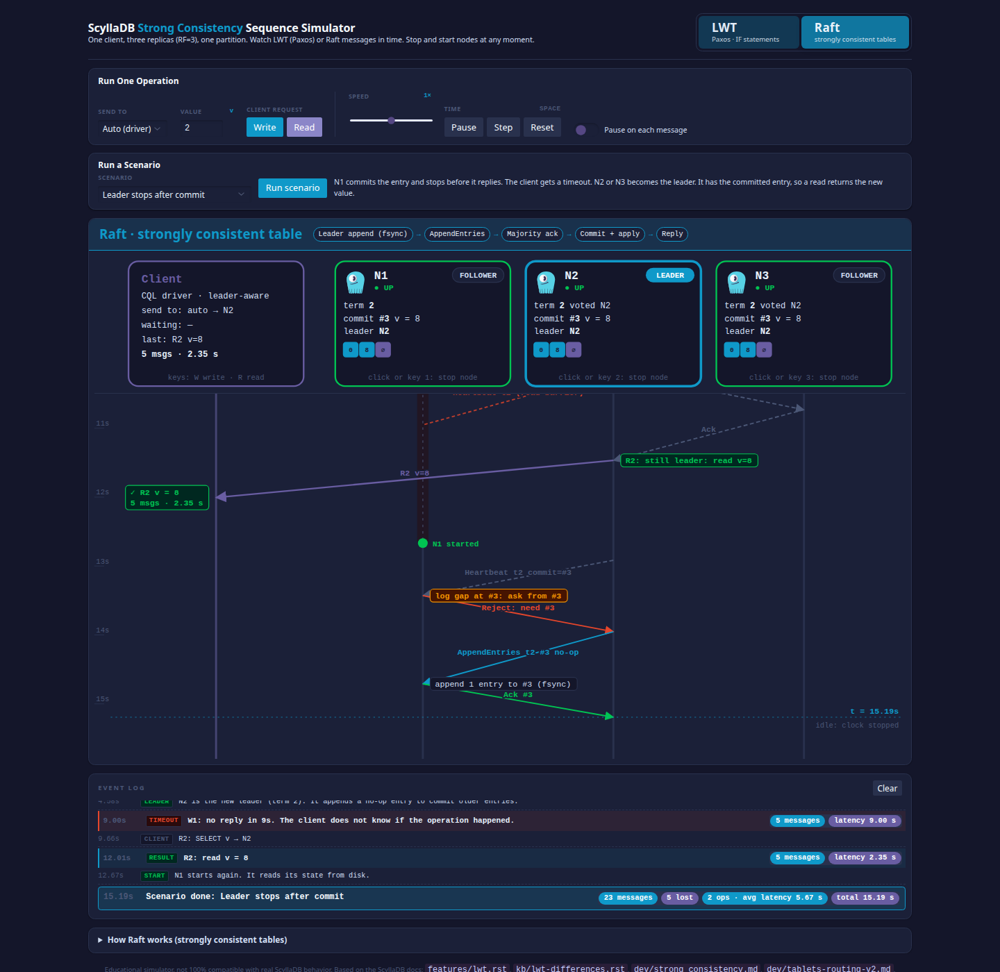

# ScyllaDB Strong Consistency Sequence Simulator

An interactive, single-file simulator that shows ScyllaDB strong consistency as a live sequence diagram. One client sends requests to three replicas (RF=3) of one partition. You see each message in time, and you can stop and start nodes at any moment.

Two protocols are available:

- **LWT (Paxos)**: statements with an `IF` clause. Prepare (with the read in the same round), IF check, Accept, Learn, and reply. `SERIAL` reads use the same Prepare round.
- **Raft (strongly consistent tables)**: tables in a keyspace with `consistency = 'global'` (experimental). The leader appends the entry, sends AppendEntries, commits on a majority of AppendReply messages, and replies. A usual write uses 6 messages. A follower forwards a request to the leader (+2 messages). A read on the leader uses only its local state (2 messages). Strongly consistent tables do not support LWT (`IF` conditions) at this time.

**Live demo:** https://tzach.github.io/scylladb-consistency-demo/

**Disclaimer:** An independent, educational simulator. It is not an official ScyllaDB product, and it is not 100% accurate to real ScyllaDB internals. Not affiliated with or endorsed by ScyllaDB, Inc.



*LWT: N1 stops after N2 accepts the value. The client gets a timeout. A SERIAL read through N2 finds the accepted value and completes it (repair).*



*Raft: leader N1 commits the entry and stops before it replies. N2 becomes the leader and keeps the committed entry. When N1 starts again, it gets the missing entries.*

## Features

- A sequence diagram with lanes for the client, N1, N2 and N3. Time goes down. A sloped arrow shows network latency.
- Node cards that show the live state of each node:
  - LWT: value, promised ballot, accepted proposal, last commit.
  - Raft: role, term, vote, log entries (committed or not), commit index.
- Stop or start a node at any time: click its card, or press `1`, `2` or `3`. A message to a stopped node is lost (✕). A stopped node keeps its disk state.
- Send a write or a read from the client (`W` and `R` keys). Send it to a specific node, or let the driver select the node.
- Raft: click Heartbeat (`H` key) to make the leader send one heartbeat round to the followers. It carries the commit index and the missing entries.
- Pause, Step (`N`), speed control, and "Pause on each message" to stop a node at an exact point in the protocol.
- 14 preset scenarios. Examples:
  - LWT: the coordinator stops after Accept, or after Prepare. Two clients race with `IF v = 0`. No quorum.
  - Raft: the leader stops after commit, or before replication. A write goes to a follower. A follower catches up after a restart.
- An event log with the message count and latency for each operation, and a summary at the end of each scenario.
- Styled with the ScyllaDB design system, light and dark themes (follows the OS).

## Run it

Open the live demo: https://tzach.github.io/scylladb-consistency-demo/

Or run it locally. This is a static, dependency-free HTML file. Clone the repo and open `index.html` in a browser. No build step and no server are necessary.

```bash
git clone https://github.com/tzach/scylladb-consistency-demo.git
cd scylladb-consistency-demo
open index.html   # or double-click it, or drag it into a browser
```

## Sources

The protocol behavior follows these documents in the ScyllaDB source tree:

- `docs/features/lwt.rst`: LWT and ScyllaDB Paxos
- `docs/kb/lwt-differences.rst`: how ScyllaDB LWT is different from Apache Cassandra
- `docs/dev/strong_consistency.md`: Raft for strongly consistent tables
- `docs/dev/tablets-routing-v2.md`: leader-aware routing
- `docs/cql/ddl.rst`: the keyspace `consistency` option

## Simplifications

- Network latency is simulated (480–780 ms for each hop), so the latencies show relative cost, not real values.
- Paxos prune and periodic Raft heartbeats are not drawn. A heartbeat tells the followers the new commit index. A follower detects a stopped leader after a random election timeout.
- The Raft read barrier is not shown. It occurs only in rare cases. Usually, the leader replies to a read from its local state.
- A write coordinator that forwards to a stale leader (+2 messages) is not shown.
- One partition, one tablet, one Raft group, RF=3.
